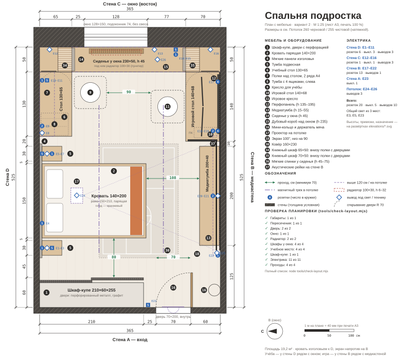

# Спальня подростка 365 × 525 — дизайн-проект

Комната для подростка 15 лет. Он увлекается компьютерами и баскетболом. В комнате нужны спальное место, учёба, игры и кино на проекторе.

**Стиль:** тёплый минимализм. Светлый тёплый серый, дуб и графит; оранжевый только в текстиле.
**Смета:** 738 500 ₽ на мебель, свет, текстиль, проектор и экран, с резервом 3 % — 760 500 ₽. Исходный бюджет 700 000 ₽, превышать его согласовано. Подробно — [furniture.md](furniture.md).

| Файл | Что внутри |
|---|---|
| [plan.svg](plan.svg) | План сверху в масштабе 1 : 25 (лист A3). Мебель, размеры, проходы, электроточки, результаты проверки |
| [index.html](index.html) | Интерактивная 3D-сцена на Three.js: 6 видов, 5 сценариев света, подсказки с размерами |
| [palette.md](palette.md) | Палитра в HEX со светоотражением (LRV), материалы пола, стен, потолка, мебели и текстиля |
| [furniture.md](furniture.md) | Мебель и свет: размеры, цены, итог по бюджету, отделка отдельной строкой |
| [lighting.md](lighting.md) | Сценарии общий, рабочий, вечерний, кино, ночник; каналы и управление |
| [layout.js](layout.js) | Все размеры в одном месте — из него строятся план и 3D |
| [tools/](tools) | Проверка планировки, генератор плана, автотест 3D-сцены |



## Исходные данные

- **Комната:** стены A и C по 365 см, стены B и D по 525 см. Потолок 260 см черновой, 255 см чистовой (натяжной). Площадь 19,2 м².
- **Окно:** на стене C, 128 × 150 см, отступ 90 см от угла со стеной D, подоконник на высоте 74 см. Выходит на восток, во двор.
- **Дверь:** на стене A, полотно 70 см, отступ 60 см от угла со стеной B. Открывается внутрь, петли со стороны стены B.
- **Ограничения:** помещение пустое, коммуникации прокладываются заново, поэтому радиатор и розетки размещены под планировку.

Стены названы так, как стоишь в дверях лицом в комнату: **A** — стена с дверью за спиной, **B** — справа, **C** — напротив, с окном, **D** — слева.

## Концепция: дуб, графит и перфорация

У хозяина комнаты два увлечения — компьютеры и баскетбол. Их объединяет **перфорация**: решётка корпуса ПК, сетка баскетбольной формы, сетка кольца. Этот мотив повторяется в дверях шкафа-купе, медиатумбе, перфопанели и решётке над радиатором. Всё остальное спокойное: тёплые серые стены и дуб.

Баскетбол присутствует в комнате, но не превращает её в спортзал:
- мини-кольцо над дверью;
- держатель для мяча за дверью;
- тонкие линии площадки на ковре;
- трансляция матча на проекторе.

Присланные фото — ориентир, не задание. Из них взяты:
- раздвижные перфорированные двери шкафа в графитовом цвете;
- сиденье у окна над открытым графитовым радиатором;
- дубовый портал вокруг окна: книжные шкафы по бокам, сиденье и короб со светодиодной лентой сверху;
- открытые дубовые полки с подсветкой над столом;
- перфопанель над игровым столом;
- мягкие вертикальные панели изголовья с контурной подсветкой;
- графитовый трек, утопленный в потолок.

## Планировка — вариант 2 с правками

Кровать стоит изголовьем к стене D, напротив неё на стене B — экран. Учёба и игра поменяны местами. В углы у окна добавлены книжные шкафы, к учебному столу — тумба с ящиками слева.

| Зона | Где | Состав |
|---|---|---|
| Хранение | Стена A, слева от двери | Шкаф-купе 210 × 60 × 255 |
| Сон | Стена D, середина | Кровать 140 × 200 изголовьем к D, мягкие панели, тумба, бра, 2 розетки |
| Учёба | Угол стен D и C, у окна | Стол 130 × 65 вдоль стены D: слева тумба с 4 ящиками, справа книжный шкаф 65 × 50 × 235. Над столом полки в 2 ряда по 35 см в свету (папка А4 стоя), верхний ряд за подъёмными дверцами; 2 розетки |
| Окно | Стена C | Парящее сиденье 230 × 50 между двумя книжными шкафами, по торцам мягкие спинки, под сиденьем радиатор; над окном дубовый короб с римской шторой |
| Игра | Угол стен B и C | Стол 140 × 68 вдоль стены B на книжном шкафу 70 × 50 × 235, системный блок под столом у опоры, перфопанель, 8 розеток, 2 интернет-розетки |
| Кино | Стена B напротив кровати | Экран 100″, медиатумба 200 × 40, проектор на потолке над изголовьем; на стене акустические рейки |

### Почему так

1. **Кровать напротив экрана.** Так выполнено условие «проектор напротив кровати»: смотреть можно лёжа. От подушки до экрана 3,3 м — это 1,5 ширины экрана в 100″, комфортное расстояние. Проектор над изголовьем, на 2,9 м от экрана.
2. **Игра у медиастены B.** Вся техника на одной стене — приставка, ПК, проектор, экран — и проводка идёт одним маршрутом. Мониторы стоят перпендикулярно окну: нет бликов и нет яркого окна за экраном. Подсветка ПК далеко от подушки.
3. **Учёба у стены D, рядом с кроватью.** Это тихий угол: экраны остаются за спиной.
   - Окно у сидящего справа. Подросток правша, поэтому лампа стоит слева, над тумбой с ящиками, иначе рука закрывает тетрадь (см. [lighting.md](lighting.md)).
   - Тумба шириной 45 см держит левый край столешницы, книжный шкаф — правый. Под столом между ними 83 см для ног.
   - Полки над столом — два ряда по 35 см в свету: папка А4 стоя (29,7 см) и 5 см запаса, чтобы её достать. Нижний ряд открытый — для того, что нужно каждый день. Верхний закрыт двумя подъёмными дверцами: распашные над столом били бы по голове. Полки начинаются на высоте 120 см, между столешницей и нижней доской 45 см — помещаются лампа и монитор.
4. **Книжные шкафы по углам стены C.** Глубина 50 см, как у сиденья, поэтому шкафы, сиденье и короб над окном складываются в один дубовый портал.
   - **Ниже уровня столов** — полки для долгого хранения на всю глубину шкафа, за двумя дверцами со стороны стола. Со стороны сиденья низ закрыт глухой стенкой.
   - **Мягкие спинки** на этих стенках — от сиденья (45 см) до уровня столов (75 см). На сиденье можно сидеть вдоль окна, опираясь спиной на любой торец.
   - **Выше столов** — к сиденью открытые полки с подсветкой, книги достаются не вставая; к столу открытые полки и закрытая секция вверху.

   Столешницы обоих столов лежат на шкафах, поэтому ножки не мешают ногам и креслу.
5. **Шкаф-купе вместо гардеробной.** Гардеробной нужно около 125 см глубины против 60 у шкафа — тогда в комнату не поместятся учебная зона и шкафы у окна. Раздвижные двери не требуют места на открывание, поэтому проход до кровати можно сделать 80 см. Перфорированный металл проветривает спортивную форму, а подсветка внутри видна сквозь дверь как ночник.
6. **Сиденье парит над открытым радиатором.** Радиатор стоит под окном, как и должен: тёплый воздух отсекает холод от стекла, окно не потеет. Чтобы тепло поднималось к стеклу:
   - сиденье висит над радиатором с зазором, у стены решётка;
   - подоконник без свеса;
   - подушки лежат у торцов, решётку не закрывают;
   - штора опускается только до подоконника.
7. **Тёмная стена B с акустическими рейками.** Вокруг экрана нет светлой стены, которая отражает свет обратно на полотно, поэтому картинка контрастнее. На тёмном фоне не видны провода и перфопанель.
   - На 360 см стены, от розетки E2 у двери до книжного шкафа, от пола до потолка — графитовые рейки на чёрном войлоке.
   - Они гасят эхо от звука фильмов и игр, и голос в микрофоне при игре с голосовым чатом чище. Звукоизоляцией от соседних комнат они не являются.
   - Рейки добавляют стене 2 см, поэтому медиатумба, игровой стол (теперь 68 см в глубину), перфопанель и розетки стоят на их поверхности. Экран опускается в 6 см перед рейками.
8. **Натяжной потолок 255 см.** Минус 5 см к высоте, но в нём утоплены трек, ниша под экран и закладная под проектор. На голом потолке пришлось бы штробить плиту или тянуть короба.
9. **Кольцо над дверью.** Над дверью 50 см стены — туда помещается мини-щит 45 × 30. Дверь его не задевает: сетка заканчивается на высоте 207 см, полотно — на 200 см.

## Проверка размеров

Все размеры в [layout.js](layout.js). Скрипт `tools/check-layout.mjs` проверяет:

| Проверка | Результат |
|---|---|
| Мебель внутри 365 × 525 × 255 и не пересекается | ✓ |
| Дверь открывается на 90°, зона R 70 свободна | ✓ |
| Перед окном выше подоконника 74 см ничего нет | ✓ |
| Радиатор открыт снизу и спереди, зазор до сиденья 4 см, над ним решётка | ✓ |
| Книжные шкафы: глубина 50 = глубине сиденья, стоят в углах и примыкают к торцам сиденья | ✓ |
| Мягкие спинки от сиденья (45) до уровня столов (75); нижним дверцам шкафов ничего не мешает | ✓ |
| Тумба с ящиками слева от сидящего, под столом 83 см для ног | ✓ |
| Полки над столом: 2 ряда в свету по 35 см ≥ 29,7 + 5, верхний ряд с дверцами | ✓ |
| Вход: дверной проём → комната | 70 см ✓ |
| Шкаф ↔ кровать | 80 см ✓ |
| Изножье кровати ↔ медиатумба | 108 см ✓ |
| К окну между учебным и игровым креслами | 90 см ✓ |

```bash
node room-project/tools/check-layout.mjs   # проверка, код выхода 1 при ошибке
node room-project/tools/build-plan.mjs     # пересобрать plan.svg после правок layout.js
```

## Электрика

Высоты — от чистого пола. Координата: для стен A и C — от стены D, для стен B и D — от стены A.

| № | Где | Что | Высота, см |
|---|---|---|---:|
| E1 | Стена A, 219 см | Выключатель 2-клавишный: общий свет и сценарии | 90 |
| E2 | Стена B, 95 см | 1 розетка для уборки | 30 |
| E3 | Стена B, 225 см, за медиатумбой | 4 розетки + интернет-розетка + гофра HDMI к проектору | 35 |
| E4 | Стена B, 405 см, над игровым столом | 4 розетки | 85 |
| E5 | Стена B, 390 см, под игровым столом у системного блока | 4 розетки + 2 интернет-розетки + гофра HDMI к проектору | 30 |
| E6 | Стена C, 280 см, у сиденья | 1 розетка с USB-C | 55 |
| E7 | Стена D, 320 см, в панели над тумбой | 2 розетки у кровати | 60 |
| E8 | Стена D, 170 см, за кроватью | 1 розетка для контроллера подсветки | 20 |
| E9 | Стена D, 308 см | Вывод под бра у кровати | 105 |
| E10 | Стена D, 366 см, над учебным столом слева, у лампы | 2 розетки | 85 |
| E11 | Стена D, 352 см | Вывод под подсветку полок | 118 |
| E12 | Стена C, 232 см | Вывод под бра у сиденья | 100 |
| E13 | Потолок, 75 / 226 | Проектор: розетка + 2 гофры HDMI | — |
| E14 | Потолок, 358 / 110 | Мотор экрана | — |
| E15 | Потолок, 238 / 500 | Лента в коробе, запас под мотор шторы | — |
| E16 | Стена C, 20 см, внутри книжного шкафа у учёбы | Подсветка полок шкафа | 225 |
| E17 | Стена C, 345 см, внутри книжного шкафа у игры | Подсветка полок шкафа | 225 |

Итого 19 розеток: у кровати 2, на учёбе 2, на игре 8. Игровую зону и медиатумбу лучше завести на отдельный автомат 16 А.

## Как открыть 3D-сцену

Модули JavaScript не работают из файла, открытого двойным щелчком, — нужен локальный сервер:

```bash
cd room-project
python3 -m http.server 8000
# открыть http://localhost:8000
```

- **Управление:** мышь — вращение, колесо — масштаб, правая кнопка — сдвиг. На телефоне: один палец, щипок, два пальца.
- **Размеры:** наведите курсор на предмет или нажмите на него.
- **Виды:** обзор, от двери, с кровати, окно и учёба, игра, сверху.
- **Свет:** день, общий, рабочий, вечерний, кино.

Three.js 0.160 лежит в `vendor/`, так что интернет нужен только для шрифтов. Без него сцена работает на системных шрифтах.

Автотест: `NODE_PATH=$(npm root -g) node tools/smoke-test.cjs http://localhost:8000/index.html`. Нужен Playwright.

## Уточнить на замере

Петли двери со стороны стены B и то, что подросток правша, подтверждены. Остаётся:

1. **Материал стен.** В монолите и панели горизонтальные штробы нельзя, тогда кабели к E4/E5 и E10 пойдут вертикально от пола.
2. **Фактические размеры окна и стояка отопления.** От них зависит подводка радиатора к сиденью.
3. **Перепад высоты потолка.** От него зависят высота шкафа-купе (255 см указано для ровного потолка) и книжных шкафов под коробом (235 см).
